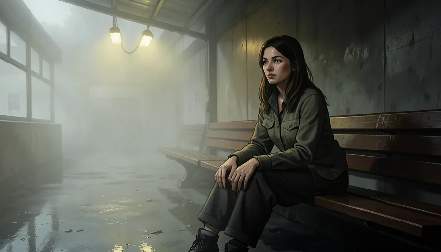

# Grosel

8 GB RTX 5060 Laptop'ta FLUX.2 Klein ve Qwen-Image 2.1 çalıştırır. Ölçülen söz: hiçbir fazda tepe VRAM 5.00 GB'ı aşmaz.

<table>
<tr>
<td width="50%"><br><sub>4K · 3840×2160 · 20 adım<br>“Loş karanlık odada masaya yaslanmış zarif Asyatik kız”</sub></td>
<td width="50%"><br><sub>1080p · soğuk · 27.3 s · 4.92 GB<br>“A lone fisherman on a wooden pier at foggy dawn”</sub></td>
</tr>
<tr>
<td><br><sub>1080p · sıcak · 11.1 s · 4.84 GB<br>“Karanlık antik kütüphanede mum ışığında el yazması inceleyen yaşlı bilgin”</sub></td>
<td><br><sub>1080p · 12.7 s · 4.92 GB<br>“Sisli bir göl kıyısında ahşap iskelede duran balıkçı”</sub></td>
</tr>
<tr>
<td><br><sub>720p · soğuk · 4.6 s · 4.92 GB<br>“Terk edilmiş tren istasyonunda bankta oturan genç kadın, sis”</sub></td>
<td><br><sub>720p · sıcak · 3.1 s · 4.18 GB<br>Aynı sahne, farklı seed; sıcak koşu</sub></td>
</tr>
</table>

Görseller gerçek üretimler; dosyalar `docs/gallery/` altında, prompt ve seed bilgisi üretim kayıtlarında.

## Kurulum

```
pip install -e .
```

Ağırlıklar repoda yok; kod `local_files_only=True` ile açılır.

```
python -c "from huggingface_hub import snapshot_download; snapshot_download('black-forest-labs/FLUX.2-klein-4B')"
python -c "from huggingface_hub import snapshot_download; snapshot_download('Qwen/Qwen-Image-2.1')"
```

## Çalıştırma

```
start_studio.bat
start_resident_qwen.bat
```

`HYPERFLUX_BACKEND=fast|classic|qwen`, port varsayılanı `7870`. Elle: `python -m web_app.server`.

## Ölçüm

| Yol | Kare | Süre | Tepe VRAM |
|---|---|---|---|
| FLUX fast | 1080p, native 1680×944, soğuk | 12.8 s | 4.92 GB |
| FLUX fast | 1080p, native 1680×944, sıcak | 11.1 s | 4.84 GB |
| Qwen yerleşik | 720p / 16, sıcak | 29.3 s | 3.91 GB |
| Qwen yerleşik | 1080p 2:3 / 40 | 132.3 s | 4.06 GB |

Donanım: RTX 5060 Laptop, 8 GB. Diğer sayılar `PlanTreni.md` içinde.

## Komut satırı

`plan` ve `solve` model ağırlığı istemez.

```
grosel plan --budget-gb 5 --width 1280 --height 704 [--json]
grosel solve --budget-gb 5 --max-time-s 8 --min-mp 0.45 --steps 4 [--json]
grosel serve
```

`solve` yerel `web_app/data/runs.json` dosyasını okur; depo bu dosyayı içermediği için temiz kopyada `no-data` döner.

## Sınırlar

- Tek GPU, tek işçi; eşzamanlı üretim yok.
- 30 s hedefi yalnız 720p/16'da; 1080p/40 Qwen yaklaşık 132 s.
- 5.00 GB tavan kartın sınırında; 6 GB rahat.
- 2K/4K tiling doğrulanmadı. NF4, FP8'e göre kompozisyonu değiştiriyor.
- KÇM kalite ekseni CLIP prompt uyumu; LPIPS ve insan A/B yapılmadı.
- Enerji ayrı ölçülmedi; süre düşünce enerji düşer, bu bir türetim.

## Test

```
python -m pytest -q
```

187 test geçiyor. Ayrıntı: `PlanTreni.md` (ölçüm günlüğü), `gpf/SPEC.md` (format deneyi), `web_app/server.py` (API).
